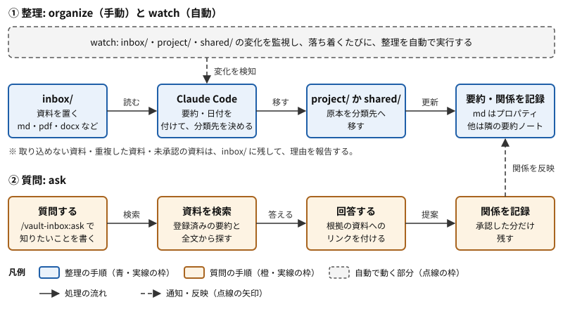

# vault-inbox

Obsidian の Vault の `inbox/` に置いた資料を、Claude Code が読んで要約・日付を付け、`project/` か `shared/` に分類するプラグイン。Obsidian と Claude Code を使う人向け。

```
/vault-inbox:organize
```

## メリット

- **分類の手間が減る**: `inbox/` に資料を置いて `organize` を実行すると、Claude Code が要約・日付を付け、`project/` か `shared/` に分類する。既存の分類先に合わない資料は、新しい分類先を提案して、承認を求める。
- **リンクでたどれる**: 各資料の要約・日付・関係が、Obsidian のプロパティに入る。md は資料自身の先頭に、それ以外は隣の要約ノート（`<資料名>.要約.md`）に書き、関係先へ `[[リンク]]` でたどれる。
- **質問で資料を引ける**: 登録した資料を検索して、根拠の資料へのリンク付きで答える。
- **手作業と両立できる**: 資料は通常のファイルのまま残る（md・pdf は Obsidian で開ける）。手作業で動かした・編集した資料にも追従する。

## 機能

次の図は、整理（`organize`・`watch`）と質問（`ask`）の動きを示す。

`inbox/` に置ける資料は、md・txt・html・pdf・docx・xlsx・pptx。`watch` は Monitor ツールが必要。



## 導入方法

Claude Code と Obsidian の Vault（フォルダ）を用意する。動作に必要なものは次のとおり。

| 項目 | 内容 |
|---|---|
| 実行環境 | Python 3.10 以上（`python` コマンドで起動できること） |
| 外部コマンド | なし |
| ライブラリ | `pypdf`・`python-docx`・`openpyxl`・`python-pptx`（`requirements.txt`。PDF・Office を読むときだけ必要） |
| ネットワーク接続 | 不要（`doctor` の版の確認だけ、github.com に接続する） |

対応 OS: 動作を確かめたのは Windows 11 のテストのみ。macOS・Linux と、Claude Code での実機の動作は未確認。

Claude Code で、マーケットプレイスから入れる（未検証。コマンド名は Claude Code の仕様から書いた）。

```
/plugin marketplace add asama0101/vault-inbox
/plugin install vault-inbox@vault-inbox
```

PDF・Office を読む依存（`pypdf` など）は、自動では入らない。入っていなければ、`/vault-inbox:init` が知らせる。

### オフラインで入れる

1. ネットワークのある環境で取得したリポジトリを、媒体で持ち込む。
2. `/plugin marketplace add <持ち込んだリポジトリのパス>` を実行する。
3. `/plugin install vault-inbox@vault-inbox` を実行する。

依存は、ネットワークのある環境で取得した `pypdf` などのパッケージを持ち込み、`python -m pip install` で入れる（未検証）。

### clone して入れる

依存を `python` と同じ Python に入れ、Vault のルートでプラグインを読み込ませる（未検証）。

```
python -m pip install -r <このリポジトリ>/vault-inbox/requirements.txt
claude --plugin-dir <このリポジトリ>/vault-inbox
```

### 環境を確かめる（`doctor`）

何も変更せずに、実行環境・保存先・依存・プラグインの版を 1 行ずつ表示する。`[NG]` があると終了コードは 3 になる。`--data` には、プラグインの保存先（`${CLAUDE_PLUGIN_DATA}`。通常は `~/.claude/plugins/data/` の下の `vault-inbox` のフォルダ）を渡す（未検証）。

```
python -X utf8 "<プラグインのパス>/scripts/vault_inbox.py" doctor --data "<保存先のパス>"
```

### アンインストール

`/plugin uninstall vault-inbox@vault-inbox` で消えるのは、プラグイン本体。利用者の Vault と `.vault-inbox/`、保存先（`${CLAUDE_PLUGIN_DATA}`）は残る。

## 使い方

Vault のルートで Claude Code を開き、初回に 1 度だけ `init` を実行する。

以下の出力は、スキルの手順（`SKILL.md`）から書いた。Claude Code での実機実行は未検証。

```
/vault-inbox:init
```

`inbox/`・`project/`・`shared/`・`.vault-inbox/` が作られ、作ったフォルダの一覧が返る。`inbox/` に資料を置く。

> **警告**: `organize` と `watch` は、原本を `inbox/` から `project/` か `shared/` へ移す。`watch` は、既存の分類先に合う資料を、確認なしで移す。元に戻す機能はない。手で `inbox/` へ戻すと、重複の資料として残り、元の登録は「消えた資料」と扱われる。戻すときは、バックアップから復元する。
> md の資料は、先頭のプロパティ（frontmatter）の `要約`・`日付`・`関連` と、印のキー `vault-inbox: true` を、実行のたびに書き換える。初回の実行で、登録済みの md のすべてが書き換わる。手でこれらを直しても、次の実行で戻る。`tags` などほかのキーは変えない（旧版が書いた `タグ` は、印のあるブロックから消える）。同名のキーを自分で使っている md、リンク・読み取り専用・UTF-8 でない md は、書き換えずに要約ノートを置く。md 以外の原本は書き換えない。要約ノート（`<資料名>.要約.md`）も作り直し、手で追記した内容は失われ、資料がなくなったノートは削除される。旧版が作った各フォルダの索引（`_index.md`・`.index.md`）も削除される。先頭に印の行がない同名のファイルは、上書きも削除もしない（資料としても取り込まれない）。`.要約.md` で終わる名前は、資料として取り込まれない。
> 実行前に、Vault を丸ごとバックアップする。`.vault-inbox/`（資料の ID・要約・関係）は、原本から作り直せない。隠しフォルダは、同期・バックアップの設定で外れる場合がある。

バックアップを取ったら、`organize` を実行する。

```
/vault-inbox:organize
```

資料が `project/` か `shared/` に移り、要約ノートか md のプロパティが更新される。分類先などの確認は、選択肢で出る。

| コマンド | 内容 |
|---|---|
| `/vault-inbox:init` | Vault を初期化する（初回に 1 度）。 |
| `/vault-inbox:organize` | `inbox/` の資料を分類して移し、要約ノートかプロパティを更新する。 |
| `/vault-inbox:watch` | Vault の変更を監視し、変化が落ち着くたびに `organize` と同じ整理を自動で行う。 |
| `/vault-inbox:ask` | 登録済みの資料を検索して答え、根拠の資料へのリンクを付ける。 |

## 困ったとき

### 初期化されていません

（Claude が伝える趣旨。画面の文言は実行ごとに変わる。）

`init` を実行していない Vault で `organize` か `watch` を実行すると、`init` を案内して止まる。`/vault-inbox:init` を実行する。

### 実行中です（`{"error": "already_running"}`）

別の `watch` が動いている。先に、動いている `watch` を止める。止めたあとも出るときは、約 30 秒待って再実行する。それでも出るときは、[ロックの解放](docs/stale-lock.md)をする。

### 実行中（`holder`）のため、あとで再実行してください

`organize` を実行したとき、別の `organize` か `watch` がロックを持っている。終わるのを待って再実行する。待っても消えないときは、[ロックの解放](docs/stale-lock.md)をする。

### Monitor が使えない

`watch` は Monitor ツールが必要。使えない環境では案内が出るので、代わりに `/vault-inbox:organize` を、必要なときに実行する。

### python が見つからない（`doctor` が起動しない）

Python 3.10 以上を入れ、`python --version` で版が出ることを確かめる。Windows で `python` が通らないときは、`py -3 -X utf8` を `python -X utf8` の代わりに使う。

### 資料が `inbox/` に残る

文字が取れない PDF（スキャン）、壊れた資料、パスワード付きの資料は、取り込めずに `inbox/` に残る。内容が同じ資料は、2 つ目以降が取り込まれない。

実機での確認の手順と、既知の制限は [docs/manual-check.md](docs/manual-check.md) にある。

## ライセンス

MIT。全文は [LICENSE](LICENSE)。依存ライブラリの出典は `vault-inbox/NOTICE` にある。
