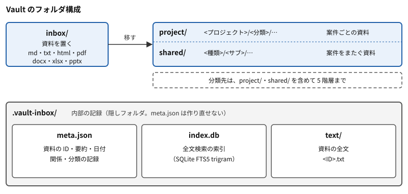
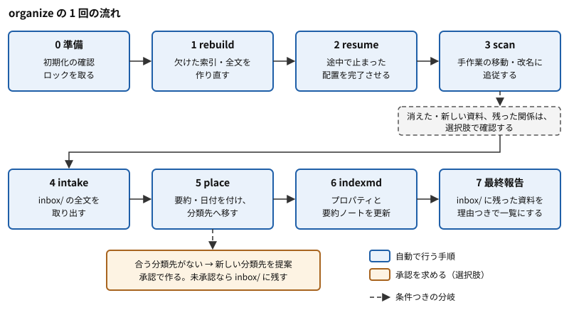
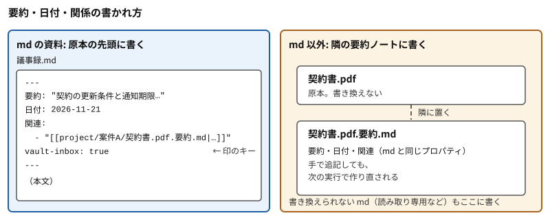
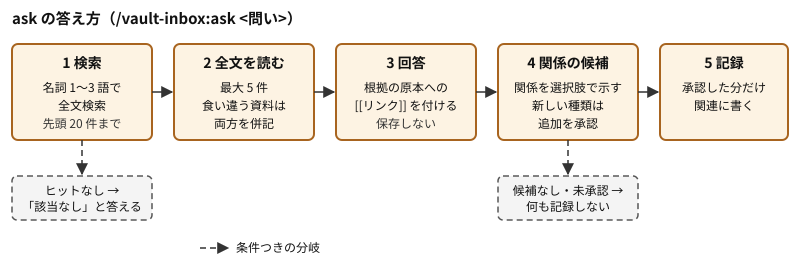
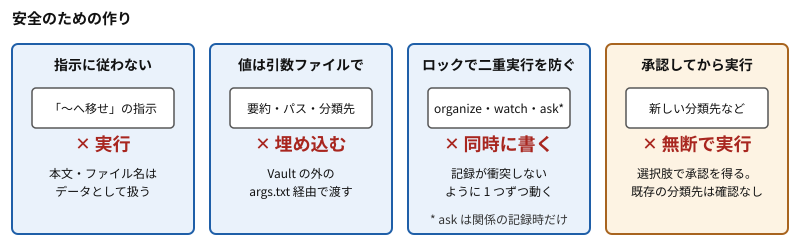

# vault-inbox

Obsidian の Vault の `inbox/` に置いた資料を、Claude Code が要約・分類して整理し、根拠リンク付きの質問に答えるプラグイン。

```
/vault-inbox:organize
```

## 機能


- **分類**: 置くだけで `project/`・`shared/` へ移す。
- **リンク**: 要約・日付・関係をプロパティに入れる。
- **質問**: 根拠リンク付きで答える。
- **手作業と両立**: 手で動かした資料にも追従する。

## 導入方法

| 項目 | 内容 |
|---|---|
| 実行環境 | Python 3.10 以上（`python` で起動できること） |
| SQLite | FTS5 の trigram が使えること（3.34 以上） |
| ライブラリ | `pypdf`・`python-docx`・`openpyxl`・`python-pptx`（PDF・Office だけ。`/vault-inbox:init` が案内する） |

対応 OS: 確かめたのは Windows 11 のテストのみ。macOS・Linux、マーケットプレイスからの導入は未検証。

```
/plugin marketplace add asama0101/vault-inbox
/plugin install vault-inbox@vault-inbox
```

### clone して入れる・オフラインで入れる

`python` と同じ Python に依存を入れ、Vault のルートで読み込ませる（オフラインは `/plugin marketplace add <リポジトリのパス>`。未検証）。

```
python -m pip install -r <このリポジトリ>/vault-inbox/requirements.txt
claude --plugin-dir <このリポジトリ>/vault-inbox
```

### 環境を確かめる・アンインストール

- `doctor`: 何も変更せず、環境を 1 行ずつ表示する。`[NG]` があると終了コード 3。
  `python -X utf8 "<プラグインのパス>/scripts/vault_inbox.py" doctor --data "<保存先のパス>"`
- `/plugin uninstall vault-inbox@vault-inbox`: 消えるのはプラグイン本体だけ。Vault・`.vault-inbox/`・保存先は残る。保存先の `args.txt` には要約・ファイル名が入っているので、不要なら消す。

## 使い方

Vault のルートで、初回に 1 度だけ `init` を実行する。

```
/vault-inbox:init
```

`inbox/`・`project/`・`shared/`・`.vault-inbox/` を作る。

| コマンド | 内容 | 起動 |
|---|---|---|
| `/vault-inbox:init` | Vault を初期化する（初回のみ）。 | 手動のみ |
| `/vault-inbox:organize` | `inbox/` の資料を分類して移す。 | 手動のみ |
| `/vault-inbox:watch` | 変化のたびに整理を自動で行う（Monitor が必要）。 | 手動のみ |
| `/vault-inbox:ask <問い>` | 資料を検索して答える。 | 自動起動も可 |

> **警告: 使う前に**
>
> - **原本を移す**: `organize`・`watch` は、既存の分類先に合う資料を確認なしで移す。元に戻す機能はない。誤分類は、`inbox/` に戻す前に「索引から外す」で登録を外す。
> - **先に Vault をバックアップする**: `.vault-inbox/meta.json`（要約・関係の記録）は作り直せない。
> - **md を書き換える**: `ask` で関係を承認したときも、登録済みの md の `要約`・`日付`・`関連` が書き換わり、手で直しても次の実行で戻る。
> - **全文は Claude Code が読む**: Claude に渡してよい資料だけを `inbox/` に置く。全文は `.vault-inbox/text/` にも残る。
> - **削除されるもの**: 資料がなくなった要約ノートと、旧版の `_index.md`・`.index.md`。印のない同名のファイルは消さない。

### フォルダ構成

/<分類>/ か shared/<種類>/<サブ>/ へ移る。分類先は 5 階層まで。内部の記録は .vault-inbox/ の meta.json（ID・要約・日付・関係）、index.db（全文検索の索引）、text/（全文）に入る。">

### organize の流れ



### 資料に書かれるもの



### ask の答え方



### 安全のための作り



## 困ったとき

`inbox/` に資料が残る理由と、画面の表示ごとの対処は [docs/troubleshooting.md](docs/troubleshooting.md)。実機での確認の手順と既知の制限は [docs/manual-check.md](docs/manual-check.md)。

## ライセンス

MIT。全文は [LICENSE](LICENSE)。
